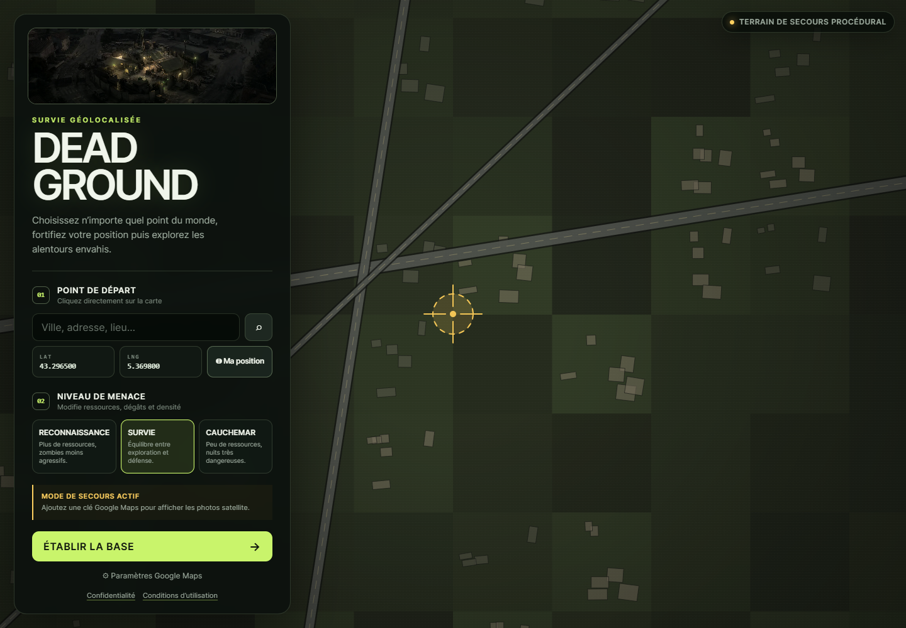
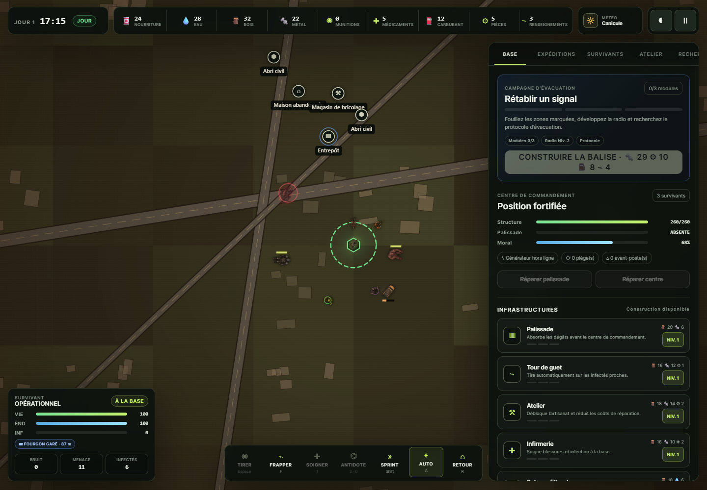
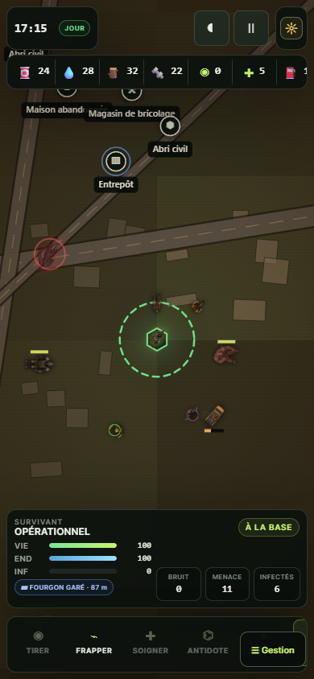

# Dead Ground: Satellite Survival — 2.2.0

**Dead Ground** est un jeu de survie zombie géolocalisé, jouable dans un navigateur. Le joueur choisit un point réel, l’utilise comme base, explore les environs, organise une communauté et prépare une évacuation au milieu d’un territoire contaminé.

Le jeu possède deux fournisseurs cartographiques interchangeables :

- **Google Maps en vue satellite**, avec recherche d’adresse et établissements réels lorsque la clé est configurée ;
- **un terrain procédural de secours**, utilisable immédiatement sans clé, sans réseau Google et hors ligne après installation de la PWA.

Les positions du joueur, de la base, des lieux, des avant-postes et des infectés restent exprimées en latitude/longitude. Le moteur de jeu ne dépend donc pas directement du fournisseur de carte.







## Les dix mises à jour majeures de la version 2.0

### 1. Météo dynamique

Ciel clair, pluie, brouillard, orage et canicule alternent pendant la partie. Chaque condition modifie réellement la vitesse, l’endurance, le bruit, la détection des zombies, la précision, les apparitions et parfois l’efficacité des défenses automatiques.

### 2. Blessures, saignement et infection

Les attaques peuvent provoquer saignement, entorse, fracture et contamination. Les médicaments, kits de terrain, médecins, infirmerie, recherche en virologie et antidotes forment désormais une chaîne de soins complète. Une infection arrivée à 100 met fin à la partie.

### 3. Communauté de survivants

La base commence avec une petite équipe. Chaque survivant possède un nom, une santé, un moral, une éventuelle blessure et un rôle modifiable : garde, médecin, ingénieur, éclaireur, producteur ou disponible. Les rôles ont des effets mesurables sur les défenses, les soins, les coûts, la portée radio, la fouille et la production.

### 4. Arbre de recherche

Huit technologies utilisent les renseignements récupérés : balistique, triage, mécanique, réseau radio, fortifications, virologie, logistique et protocole d’évacuation. Les prérequis empêchent de débloquer les technologies avancées dans le désordre.

### 5. Atelier, inventaire et artisanat

Le joueur peut fabriquer des caisses de munitions, kits de terrain, kits de réparation, pièges et antidotes. Les pièges sont déployables autour de la base et participent réellement aux combats.

### 6. Missions radio dynamiques

Des missions limitées dans le temps apparaissent chaque jour : sauvetage, réserve signalée, nid à détruire, archives prioritaires ou fourgon abandonné. Elles utilisent de vrais lieux du monde, donnent des récompenses et peuvent recruter de nouveaux survivants.

### 7. Nids et mutations avancées

Des foyers infectés renforcent progressivement la menace et bloquent la fouille tant qu’ils ne sont pas nettoyés. Le bestiaire comprend maintenant rôdeur, coureur, hurleur, colosse, cracheur, blindé et Alpha de la horde.

### 8. Avant-postes de secteur

Un lieu fouillé et sécurisé peut devenir un avant-poste. Il étend la zone couverte, sert de refuge et produit quotidiennement des ressources correspondant à sa catégorie. La recherche logistique améliore sa portée et son rendement.

### 9. Fourgon d’expédition

Une mission permet de retrouver un véhicule abandonné. Après la recherche mécanique et les réparations, le fourgon augmente fortement la vitesse, consomme du carburant, absorbe une partie des dégâts et possède sa propre intégrité.

### 10. Campagne d’évacuation et victoire

Trois modules de signal sont disséminés dans le secteur. Après les avoir récupérés, le joueur doit développer les technologies nécessaires, améliorer la radio, construire une balise puis appeler le convoi. Cela déclenche un siège final spécifique ; repousser cette dernière horde termine réellement la campagne par une victoire.

## Fonctionnalités générales

- sélection du départ par clic, coordonnées, recherche d’adresse ou géolocalisation ;
- Google Maps satellite avec couche tactique canvas synchronisée au zoom et au déplacement ;
- Google Places pour convertir les établissements voisins en objectifs réels ;
- monde hybride complété automatiquement par des lieux procéduraux ;
- distances et déplacements calculés en mètres ;
- cycle jour/nuit accéléré, consommations quotidiennes, productions et vagues à 20 h ;
- tir manuel, tir automatique, mêlée, sprint, soins, antidote et véhicule ;
- bruit, menace, santé, endurance, moral, infection et intégrité des défenses ;
- neuf ressources : nourriture, eau, bois, métal, munitions, médicaments, carburant, pièces et renseignements ;
- sept infrastructures, chacune améliorable sur trois niveaux ;
- trois difficultés : Reconnaissance, Survie et Cauchemar ;
- sauvegarde automatique locale, copie de secours, migration des sauvegardes 1.x, import et export JSON ;
- interface responsive, tactile et clavier ;
- sons procéduraux Web Audio ;
- pack de onze illustrations originales générées avec OpenAI et optimisées pour l’interface ;
- neuf atlas tactiques originaux issus d’ImageGen : joueur, sept infectés et fourgon, avec poses articulées et clips d’action ; huit directions pour les acteurs biologiques et rotation continue du fourgon ;
- déclenchement fidèle des animations de tir, mêlée, blessure, attaque, cri, crachat, mort et immobilisation du fourgon ;
- fallback vectoriel immédiat si un atlas tarde ou échoue, et poses stables lorsque la réduction des animations est activée ;
- PWA installable et mode procédural hors ligne ;
- build statique prêt pour Vercel ;
- contrôle syntaxique multiplateforme, audit TypeScript `checkJs`, tests automatisés et validation du build.

## Monde réel avec Google Places

Lorsqu’une nouvelle partie est lancée avec les API Google configurées, le jeu analyse un rayon de **1 500 mètres** autour de la base et transforme jusqu’à vingt résultats en lieux de jeu. La requête Places ne demande que `id` et `location`. Le nom tactique et la catégorie de chaque objectif sont générés par Dead Ground, indépendamment du contenu descriptif Google.

La sauvegarde ne conserve ni nom, ni adresse, ni type descriptif, ni lien Google. Elle peut garder l’identifiant du lieu et ses coordonnées pendant **30 jours au maximum**. À expiration, les coordonnées Google sont remplacées par une position procédurale avant la sauvegarde suivante.

Les résultats trop proches de la base, hors zone, en doublon ou presque superposés sont écartés. Le compteur affiché correspond uniquement aux lieux réellement acceptés. Si l’API ne renvoie pas assez de résultats, les emplacements restants sont générés procéduralement ; une panne ou un quota dépassé ne bloque pas la partie.

## Installation locale

Prérequis pour les commandes de développement : **Node.js 20 ou plus récent**. Le jeu n’a aucune dépendance npm d’exécution ; TypeScript est verrouillé comme dépendance de développement pour rendre l’audit `checkJs` reproductible.

```bash
npm install
npm run validate
npm run dev
```

Ouvrir ensuite :

```text
http://localhost:4173
```

L’ouverture directe de `index.html` en `file://` est déconseillée : les modules ES, le service worker, la géolocalisation et les restrictions Google fonctionnent correctement sur HTTP ou HTTPS.

## Activer Google Maps, Places et la recherche d’adresse

Le mode procédural fonctionne sans clé. Pour le mode réel :

1. créer un projet Google Cloud avec facturation Maps Platform ;
2. activer **Maps JavaScript API** ;
3. activer **Places API (New)** ;
4. activer **Geocoding API** pour la recherche d’adresse ;
5. créer une clé de navigateur ;
6. la restreindre aux domaines autorisés et aux seules API utilisées.

Trois méthodes sont disponibles.

### Depuis l’interface

Ouvrir **Paramètres Google Maps**, coller la clé puis enregistrer. Elle reste dans le stockage local du navigateur.

### Pour le développement local

```js
// config.local.js
window.DEAD_GROUND_CONFIG = {
  googleMapsApiKey: "VOTRE_CLE_NAVIGATEUR_RESTREINTE"
};
```

### Pour Vercel ou un build automatisé

Définir :

```text
GOOGLE_MAPS_API_KEY
```

Puis exécuter :

```bash
npm run build
```

Le détail des restrictions et du diagnostic se trouve dans [`GOOGLE_MAPS_SETUP.md`](GOOGLE_MAPS_SETUP.md).

## Contrôles

| Action | Souris ou tactile | Clavier |
|---|---|---|
| Définir une destination | clic sur la carte ou bouton d’un lieu | — |
| Tirer | bouton **Tirer** | `Espace` |
| Frapper | bouton **Frapper** | `F` |
| Soigner / stabiliser | bouton **Soigner** | `1` |
| Utiliser un antidote | bouton **Antidote** | `2` |
| Sprint | bouton ou maintien | maintenir `Maj` |
| Activer le fourgon | bouton véhicule | `V` |
| Tir automatique | bouton **Auto** | `A` |
| Retour à la base | bouton **Retour** | `R` |
| Pause / reprise | bouton pause | `Échap` |

Sur mobile, le bouton **Gestion** ouvre les panneaux Base, Expéditions, Survivants, Atelier, Recherche, Missions et Journal.

## Boucle de campagne

1. Choisir une position et une difficulté.
2. Explorer les lieux découverts et suivre les transmissions radio.
3. Éliminer les défenseurs, nettoyer les nids et fouiller les bâtiments.
4. Revenir avec nourriture, eau, matériaux, soins, carburant et renseignements.
5. Affecter les survivants, construire, rechercher et fabriquer.
6. Sécuriser des avant-postes et réparer le fourgon pour atteindre la périphérie.
7. Repousser les vagues nocturnes tout en maintenant les rations et le moral.
8. Récupérer les trois modules, construire la balise et survivre au siège final.

## Infrastructures

- **Palissade** : absorbe les dégâts avant le centre de commandement.
- **Tour de guet** : engage automatiquement les infectés et consomme des munitions.
- **Atelier** : débloque l’artisanat et réduit les coûts de réparation.
- **Infirmerie** : soigne le joueur et les survivants, ralentit l’infection.
- **Potager filtrant** : produit nourriture et eau chaque matin.
- **Générateur** : renforce les défenses nocturnes en consommant du carburant.
- **Radio longue portée** : révèle les secteurs, augmente les missions et prépare l’évacuation.

## Sauvegardes 1.x

Une sauvegarde de la version 1.0 ou 1.1 est migrée automatiquement vers le schéma 2.0. Les positions, ressources, infrastructures, progression, lieux et statistiques existantes sont conservés. Les nouveaux systèmes reçoivent des valeurs cohérentes, et une copie secondaire normalisée et nettoyée est écrite avant la reprise du jeu.

## Commandes de qualité

```bash
npm run check         # syntaxe JavaScript
npm run check:types   # audit TypeScript allowJs + checkJs
npm test              # suite de tests Node
npm run build         # production dans dist/
npm run validate      # syntaxe + types + tests + build + validation PWA
```

La commande `npm run validate` contrôle aussi les imports ES, les fichiers PWA, les références HTML, les pages légales et l’absence de fichiers de développement indésirables dans le paquet construit.

## Architecture

```text
index.html                   coque de l’application
styles.css                  interface responsive et effets météo
src/main.js                 orchestration, cartes, sauvegarde, événements
src/engine.js               simulation temps réel et règles de jeu
src/world.js                monde, missions, POI, survivants et infectés
src/constants.js            équilibrage des dix grands systèmes
src/migrations.js           migration et normalisation des sauvegardes
src/real-places.js          conversion Google Places vers les POI
src/renderer.js             couche tactique canvas
src/maps/google-map.js      satellite, géocodage, Nearby Search, projection
src/maps/fallback-map.js    terrain procédural de secours
src/ui.js                   HUD, panneaux et fenêtres modales
src/visuals.js              registre et attribution stable des visuels originaux
src/assets/visuals/         pack WebP OpenAI inclus dans le shell hors ligne
src/sprites.js              catalogue, préchargement et lecteur des atlas
src/assets/sprites/         neuf atlas PNG et manifeste direction-major
src/storage.js              sauvegarde principale, secours, import/export
src/audio.js                sons Web Audio
service-worker.js           cache des seuls fichiers appartenant au jeu
privacy.html / terms.html   information et conditions destinées au joueur
scripts/build_sprite_atlases.py  reconstruction depuis les maîtres externes
scripts/                    build et validation statique
tests/sprites.test.mjs      format, pixels, sampling et événements des atlas
tests/                      tests moteur, migration, rendu et simulation longue
```

La provenance, les formats et la direction artistique du pack sont documentés dans [`docs/OPENAI_VISUALS.md`](docs/OPENAI_VISUALS.md).

## Déploiement Vercel

Le fichier `vercel.json` configure la commande de build, le dossier `dist`, le service worker et les principaux en-têtes de sécurité. Après import du dépôt dans Vercel :

1. ajouter éventuellement `GOOGLE_MAPS_API_KEY` ;
2. déployer ;
3. ajouter le domaine HTTPS de production aux restrictions HTTP de la clé Google ;
4. créer une nouvelle partie pour générer les lieux du secteur choisi.

Sans variable Google, la production est volontairement déployée en mode procédural : elle reste entièrement jouable et n’expose aucune clé.

## Limites actuelles

- le déplacement est géographique en ligne directe : il ne suit pas encore les routes, murs, reliefs ni propriétés privées ;
- les établissements sont des objectifs tactiques, pas des intérieurs 3D visitables ;
- les données restent locales au navigateur, sans compte ni synchronisation cloud ;
- la campagne est solo ;
- l’imagerie satellite et Places en direct nécessitent une clé Google valide, une facturation active et les bonnes restrictions ;
- le mode Google en direct doit toujours être revalidé sur le domaine final avec la clé réelle du propriétaire.

## Reprise avec Codex

Lire [`CODEX_HANDOFF.md`](CODEX_HANDOFF.md), [`GAME_DESIGN.md`](GAME_DESIGN.md) et [`QA_REPORT.md`](QA_REPORT.md) avant toute modification importante.

## Licence

Le code est fourni sous licence MIT. Les cartes, données, images, logos et attributions Google restent soumis aux conditions de Google Maps Platform et ne font pas partie de cette licence.

Consulter aussi la [politique de confidentialité](privacy.html) et les [conditions d’utilisation](terms.html).
